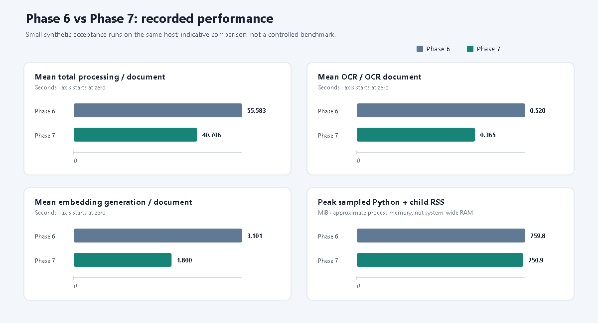

# Evaluation and Performance Report

## Summary and evidence sources

This report distinguishes two independent Phase 7 exercises. The six-format live run evaluates end-to-end parsing, local services, embeddings, and persistence. The labeled evaluator evaluates extraction values on three labeled synthetic text samples. Their document counts, comparison units, and success criteria are not combined.

| Evidence | Source |
|---|---|
| Phase 6 baseline live acceptance | [phase6_acceptance_results.json](./phase6_acceptance_results.json) |
| Phase 7 live six-format acceptance | [phase7_live/phase6_acceptance_results.json](./phase7_live/phase6_acceptance_results.json) |
| Phase 7 labeled Ollama extraction evaluation | [phase7_live/evaluation_summary.json](./phase7_live/evaluation_summary.json) |
| Browser/host test context | [phase7_acceptance_report.md](./phase7_acceptance_report.md) |
| Evaluator implementation | [../backend/tests/evaluate.py](../backend/tests/evaluate.py) |
| Labeled ground truth | [../backend/tests/fixtures/invoices.json](../backend/tests/fixtures/invoices.json) |

Both Phase 7 live files were generated on 2026-11-08 UTC on the Intel Core i7-1355U, 16 GB RAM, Intel Iris Xe host using local CPU inference. Ollama was configured for `qwen2.5:3b`; embeddings used `sentence-transformers/all-MiniLM-L6-v2` (384 dimensions); OCR used `E:\Tesseract-OCR\tesseract.exe` with Tesseract 5.5.3.20260724. The six-format run used an isolated SQLite database and upload directory and did not regenerate the baseline fixtures; their hashes were checked unchanged.

## A. Live six-format processing acceptance

The live harness processed six synthetic documents through API upload, the SQL worker, actual local Ollama/Tesseract/embeddings, and persistence. **6/6 passed and all 12/12 expected line items persisted.** CSV and XLSX were deterministically extracted without Ollama; the scanned PDF completed as `requires_review`. This is a pipeline acceptance result, not a real-world accuracy evaluation. Per-document inputs, statuses, service calls, and timings are recorded in the [Phase 7 acceptance report](./phase7_acceptance_report.md) and [machine-readable results](./phase7_live/phase6_acceptance_results.json).

### Performance and memory

| Metric | Phase 6 | Phase 7 |
|---|---:|---:|
| Mean LLM duration (model-backed documents) | 78.087 s | 57.869 s |
| Mean invoice-extraction duration (all six) | 52.061 s | 38.582 s |
| Mean OCR duration per OCR document | 0.520 s | 0.365 s |
| Mean embedding generation per document | 3.101 s | 1.800 s |
| Mean end-to-end processing per document | 55.583 s | 40.706 s |
| Peak sampled Python process + child-process RSS | 759.8 MiB | 750.9 MiB |



Editable vector source: [performance_comparison.svg](./performance_comparison.svg). Each panel uses its own zero-based scale and units; bar lengths are comparable only within that panel. The chart summarizes the recorded synthetic runs and is not a controlled benchmark.

The Phase 7 mean total duration is **26.8% lower** than the recorded Phase 6 mean (14.877 seconds/document difference). These are six-document synthetic runs, not controlled repeated benchmarks. Model warm/cold state and host load can affect timing. Embedding measurements include first-use model initialization (10.615 seconds for the first Phase 7 document); therefore, the 1.800-second average is not a warm-only embedding estimate. Peak RSS was sampled approximately every 50 ms for the acceptance Python process and child processes; it is not system-wide memory attribution.

CSV and XLSX took 0.056 and 0.320 seconds end-to-end, respectively, and bypassed LLM inference. This supports that deterministic parsing avoids unnecessary model calls for these structured fixtures; it does not prove a general performance or quality advantage on arbitrary spreadsheets.

Historical Phase 5/6/7 line-item outcomes: Phase 5 recorded digital PDF 0/2, CSV 0/2, XLSX 1/2, and scanned PDF/PNG/JPG 1/2 each; Phase 6 and Phase 7 recorded 2/2 for all six formats. All figures refer to synthetic fixtures, not a real-world extraction corpus.

## B. Labeled extraction accuracy evaluation

The evaluator in `backend/tests/evaluate.py` loads three cases from `backend/tests/fixtures/invoices.json` and calls the configured `extract_invoice_data()` path, which uses the configured local Ollama model. It does not run OCR: source text is supplied directly as labeled input.

### Method

- Eight scalar fields are compared: invoice number/date, supplier/customer, subtotal, tax, total, and currency.
- For scalar values, `None` matches only `None`; strings compare case-insensitively after trimming; numeric values use `math.isclose` with absolute tolerance 0.01 and relative tolerance 0.001.
- Dates are normalized for the supported ISO and numeric formats before equality checking.
- Each invoice's line-item list is one comparison unit. The lists must have equal length and order; each corresponding item compares description, quantity, unit price, tax, and line total. Evidence and confidence metadata are intentionally not ground-truth mismatch fields.
- One invoice is an exact match only when all eight scalar comparisons and the line-item-list comparison match.
- Field-level accuracy is computed across successful extractions only. Failed extractions are reported separately and are not converted into guessed field values. This run had no failed extraction.
- Total and per-document wall-clock extraction duration are measured by the evaluator. OCR, upload, document persistence, and full end-to-end embedding generation are outside this metric.

### Results

| Metric | Phase 7 result |
|---|---:|
| Labeled synthetic invoices | 3 |
| Successful / failed extractions | 3 / 0 |
| Scalar comparisons | 24 |
| Ordered all-or-nothing line-item-list comparisons | 3 |
| Total comparison units | 27 |
| Correct comparison units | 27/27 |
| Exact invoice matches | 3/3 |
| Expected null scalar values handled correctly | 2/2 |
| Total extraction time | 162.143899 s |
| Average extraction time | 54.047966 s/document |

All eight scalar categories and the ordered line-item-list category were 3/3 on this fixture set. The “27/27” denominator is not 27 independent scalar fields: it is 24 scalar checks plus three complete-list checks.

### Limitations

- **Real customer invoice accuracy: NOT TESTED.** The labeled dataset has only three synthetic invoices and does not represent the layout, language, vendor, currency, scan quality, or exception diversity of production.
- **OCR accuracy: NOT TESTED by the labeled evaluator.** It supplies text directly. OCR use and handoff are evidenced separately by live six-format acceptance.
- **PostgreSQL execution: NOT TESTED.** The live acceptance and performance measurements used isolated SQLite databases.
- **Production security and scalability: NOT TESTED.** These synthetic runs do not establish deployment security, multi-user behavior, or production throughput.
- The 100% measured result is a synthetic fixture score, not production or real-world accuracy and not evidence of generalization.
- Results are specific to local `qwen2.5:3b`, the current prompt/schema, deterministic extraction logic, hardware, and comparison method. A larger permission-cleared labeled dataset is needed before making broader accuracy claims.

## Reproducibility

Run the labeled evaluator with the local Ollama service and required model available:

```powershell
$ProjectRoot = (Get-Location).Path
Set-Location (Join-Path $ProjectRoot 'backend')
$env:PYTHONPATH = '.'
.\.venv\Scripts\python.exe tests\evaluate.py
```

By default this writes `backend\reports\evaluation_summary.json`; preserve a copy before rerunning if the current evidence must remain unchanged. The live acceptance runner is `backend\scripts\run_acceptance_tests.py`; it regenerates fixture files in its acceptance fixture directory. Use an isolated copy/redirected output when preserving previous artifacts. Neither live script is required to rerun merely to read this report.
